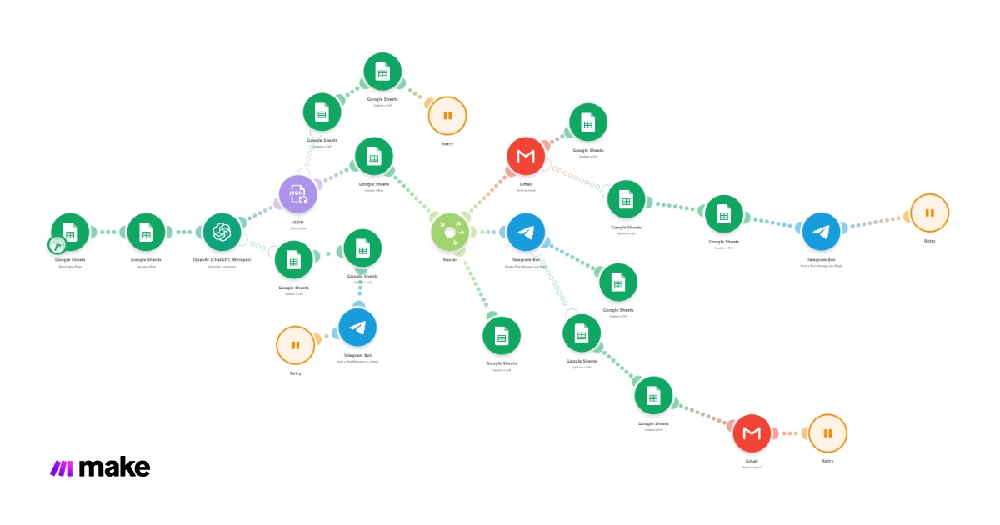
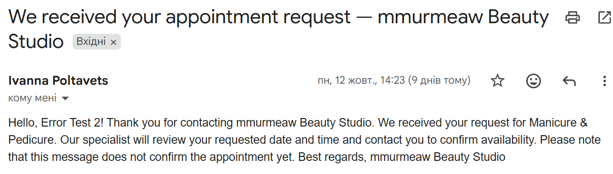
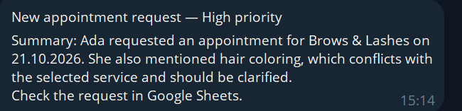
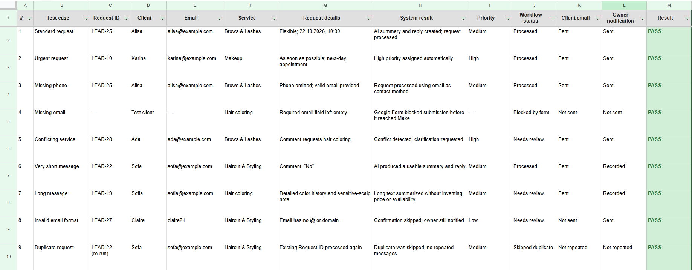

# AI Lead & Booking Assistant
### Make.com Automation · OpenAI Integration

A working automation prototype that collects beauty salon appointment requests, generates structured AI summaries, assigns rule-based priorities and sends client and owner notifications.

**Independent portfolio prototype · Ivanna Poltavets · 2026**

**Tools:** Make, OpenAI API, Google Forms, Google Sheets, Gmail, Telegram.

## The problem

Manually reviewing appointment requests can lead to delayed replies, overlooked urgent enquiries and inconsistent records.

This prototype brings requests, AI summaries, processing statuses and notification results into one workflow, while leaving appointment confirmation to a salon employee.

## My contribution

- Built the Make scenario and connected the services.
- Configured structured AI output and instructions for handling incomplete or conflicting requests.
- Implemented rule-based priorities, processing statuses and repeat-processing protection.
- Added email-format validation, notification tracking and error-handling routes.
- Tested the prototype and documented 15 demo scenarios.

## How it works

**Google Form → Google Sheets → Make → OpenAI → Google Sheets → Gmail / Telegram**

### 1. Collect and store the request

The form collects the client's name, email, optional phone number, selected service, urgency, preferred date and time, additional comments and consent to data processing.

The original submission is stored in Google Sheets before AI analysis and notifications begin. A later failure in OpenAI, Gmail or Telegram therefore does not remove the original request.

The spreadsheet also stores processing fields: Request ID, AI summary, service category, missing information, reply draft, priority, status, processing time, notification flags and error information.

### 2. Protect against repeated processing

Make selects rows without a Request ID. At the start of processing, it assigns an ID in the format `LEAD-<row number>` and sets the status to `Processing`.

An existing Request ID prevents the same row from entering the normal processing flow again, avoiding repeated AI calls and notifications.

This protects against processing the same row twice. It does not identify separate form submissions with similar content.

### 3. Analyse the request with AI

OpenAI returns structured JSON with four fields:

| Field | Purpose |
| --- | --- |
| `summary` | A summary of up to two sentences |
| `category` | Service category |
| `reply_draft` | A polite draft response for staff |
| `missing_data` | Information that needs clarification |

The AI is instructed to recognise conflicting services, multiple-service requests and off-topic comments. It should not invent prices, discounts, treatment durations or staff availability, or claim that an appointment is confirmed.

A phone number is not treated as required when an email address is available.

**The AI reply draft is saved in Google Sheets for staff review. It is not the automatic email sent to the client.**

### 4. Assign priority and status

Priority is calculated by Make using fixed rules:

| Urgency selection | Priority |
| --- | --- |
| As soon as possible | High |
| Within the next 2 days | High |
| Next week | Medium |
| I am flexible | Medium |
| Other values | Low |

After AI analysis:

- `Processed` — no missing information is identified.
- `Needs review` — information needs clarification or the email format is invalid.
- `Error` — a technical failure occurs.

Priority and status are separate. An urgent request can be both `High` priority and `Needs review`.

### 5. Acknowledge the client and notify the owner

For an email address that passes basic format validation, Gmail sends a standard acknowledgement confirming receipt of the request. It explains that staff must check availability and confirm the appointment.

After successful sending, `Confirmation Sent` is set to `TRUE`.

If the email format is invalid, the acknowledgement is skipped, the request is marked `Needs review`, and the owner-notification route remains available.

Telegram notifications are configured for all normally processed requests, not only High-priority requests. They include the priority, client details, service, preferred date and time, AI summary and a reminder to review Google Sheets.

After successful sending, `Owner Notified` is set to `TRUE`.

## Error handling and recovery

| Failure | Current handling |
| --- | --- |
| OpenAI call fails | Set `Error`, record the error and notify the owner through Telegram |
| AI output cannot be parsed as JSON | Set `Error` and stop downstream processing; see known issues below |
| Gmail acknowledgement fails | Set `Error`, record an error entry and notify the owner through Telegram |
| Telegram owner notification fails | Set `Error`, record the error and attempt a fallback email to the owner |
| Invalid email format | Skip the client email, set `Needs review` and continue the owner-notification route |

The fallback email includes request details, the spreadsheet row reference and error information.

Failed executions are retained as incomplete executions in Make for inspection and controlled recovery. Recovery must account for actions that already succeeded; the Request ID check should not be treated as a guarantee against every possible duplicate during retries.

## Demo outputs

### Client acknowledgement

The email acknowledges the request without confirming the appointment. The sample comes from a demo using an error-test name.

### Owner notification

This example identifies a conflict between the selected service and the client's comment. Contact rows and unrelated conversations have been excluded from the image.

### Test results

The demo test log contains **15 scenarios, all marked PASS**, including urgent, incomplete, conflicting, duplicated and off-topic requests.

The screenshot shows the first nine cases. See [TESTING.md](TESTING.md) for all 15 results, notification outcomes and testing notes.

## Known issues

Two error-handling details remain to be corrected:

- JSON-parsing and Gmail error handlers currently write the literal text `Error message` instead of the actual technical error.
- The JSON-parsing failure route does not send a separate owner notification.

The current version therefore does not provide detailed error logging and owner alerts for every failure path.

## Scope and limitations

- This is an independently built portfolio prototype.
- It processes appointment requests; it does not provide live calendar availability or confirmed bookings.
- A salon employee must confirm the final appointment.
- The prototype is configured to check for new requests approximately every 15 minutes. Timing depends on the Make configuration and account plan.
- Email-format validation does not confirm that a mailbox exists or that a message was delivered.
- Deployment requires connected Google, Gmail, Telegram and OpenAI accounts.
- Service categories, messages and priority rules need to be adapted for each business.

## Repository contents

- `README.md` — project overview, workflow and current limitations.
- `TESTING.md` — documented demo scenarios and results.
- `assets/` — workflow and output screenshots.

The live Make blueprint is not included because it contains account-specific configuration and identifiers. A sanitised export can be added separately after review.

This repository presents the project and its demo evidence; it is not a ready-to-import deployment package.
